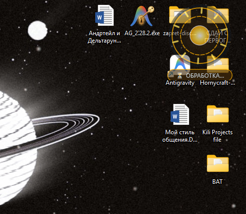
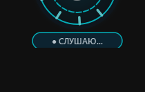

# ⚡ J.A.R.V.I.S. Live Assistant (ECS Edition)

<p align="center">
  
  
</p>

<p align="center">
  <strong>Автономный голосовой ИИ-ассистент реального времени с непрерывным зрением и архитектурой Entity-Component System (ECS)</strong>
</p>

<p align="center">
  
  
  
  
  
  
</p>

---

## 📖 О проекте

**J.A.R.V.I.S. Live Assistant** — это настольный голосовой агент нового поколения для Windows, объединяющий:
1. **Google Gemini 3.8 Live API**: Полный дуплексный WebSocket-протокол реального времени (входящий PCM 16 кГц, исходящий PCM 24 кГц). Время реакции на голос составляет около **1.1 секунды** без задержек на стенограмму и генерацию текста.
2. **Непрерывное HD-зрение (1280×720)**: Оптический поток анализирует экран в реальном времени, считывает кириллицу, кнопки, открытые вкладки браузера и элементы любых программ.
3. **Архитектура Entity-Component System (ECS Core)**: Отказ от жёстко зашитых названий окон и кнопок. Мир вашего ПК представляется как динамический набор *Сущностей (Entities)* с *Компонентами (Components)* — пространственными, визуальными, оконными и семантическими.
4. **Голографический интерфейс Arc Reactor (PyQt6)**: Полупрозрачный виджет в стиле дугового реактора Тони Старка со сглаженной векторной анимацией импульсов, который отображает текущий статус (ожидание, прослушивание, анализ, речь) и **никогда не перехватывает фокус ввода** (`WindowDoesNotAcceptFocus`).

---

## 🔑 Где взять API-ключ и что вставлять?

Для работы ассистента требуется бесплатный ключ **Google Gemini API**:

### Шаг 1. Получение API-ключа (Бесплатно)
1. Перейдите на портал разработчиков: **[Google AI Studio](https://aistudio.google.com)**.
2. Авторизуйтесь под своим аккаунтом Google.
3. В левом меню нажмите синюю кнопку **«Get API key»** (или **«Create API key»**).
4. Нажмите **«Create API key in new project»** (или выберите существующий проект).
5. Скопируйте полученную строку ключа (она начинается с символов `AIzaSy...`).

---

### Шаг 2. Куда и как вставлять ключ

В папке проекта находится готовый шаблон конфигурации: `config.example.json`.

1. Создайте копию файла `config.example.json` и назовите её **`config.json`**.
2. Откройте `config.json` в любом текстовом редакторе (Блокнот, Notepad++, VS Code).
3. Вставьте ваш скопированный ключ в строке `"gemini_api_key"`:

```json
{
  "gemini_api_key": "ВСТАВЬТЕ_СЮДА_ВАШ_КЛЮЧ_AIzaSy...",
  "model": "gemini-3.8-live",
  "voice_name": "Fenrir",
  "proxy": "",
  "screen_vision": true,
  "opacity": 0.78,
  "wake_word": "jarvis"
}
```

#### Пояснение параметров конфигурации:
- **`gemini_api_key`**: Ваш личный API-ключ Google AI Studio.
- **`model`**: Модель реального времени (по умолчанию `gemini-3.8-live`).
- **`voice_name`**: Тембр голоса Джарвиса (`Fenrir`, `Aoede`, `Puck`, `Charon`, `Kore`).
- **`proxy`**:
  - По умолчанию поле пустое (`""`) — Джарвис подключается напрямую к серверам Google.
  - **Для пользователей из РФ и регионов с блокировками**: укажите адрес локального прокси (например, `"http://127.0.0.1:10809"` для v2ray / NekoRay / Xray или `"http://127.0.0.1:7890"` для Clash).
  - В систему встроен умный детектор: если прокси временно выключен, Джарвис не упадет с ошибкой, а автоматически продолжит работу через прямое соединение.
- **`screen_vision`**: `true` — постоянный фоновый захват экрана высокого разрешения; `false` — только голос.
- **`opacity`**: Прозрачность голографического кольца реактора на рабочем столе (от `0.1` до `1.0`).

> [!IMPORTANT]
> Файл `config.json` автоматически добавлен в `.gitignore`. Ваши личные ключи защищены и никогда не попадут в открытый репозиторий GitHub.

---

## 🛠️ Установка и первый запуск

### 1. Клонирование репозитория
Откройте терминал (PowerShell или Командную строку) и выполните:
```bash
git clone https://github.com/GGintarou/JARVIS-Live-Assistant.git
cd JARVIS-Live-Assistant
```

### 2. Установка зависимостей
Рекомендуется использовать Python версии **3.11** или новее:
```bash
pip install -r requirements.txt
```

### 3. Запуск JARVIS (3 удобных способа)

* **Способ 1 (Самый простой, в 1 клик):**
  Дважды кликните по файлу **`Запустить JARVIS Live.bat`** (или **`start_jarvis.bat`**).
* **Способ 2 (Фоновый запуск без черного окна консоли):**
  Дважды кликните по файлу **`run_jarvis.vbs`**. Джарвис запустится в фоне, на экране появится полупрозрачный реактор, готовый слушать ваши команды.
* **Способ 3 (Запуск через терминал с выводом всех логов):**
  ```bash
  python jarvis_live.py
  ```

---

## 🎙️ Как общаться с Джарвисом: Умный режим сна и команды

### 💤 Локальный Wake-Word и 15-секундное окно диалога
- **Режим ожидания (`💤 ЖДУ «ДЖАРВИС»`)**:
  Джарвис **не мешает общаться в Discord, играть с друзьями или разговаривать по телефону**. Локальный автономный движок Vosk на лету (за ~150 мс, 0 токенов, 100% приватно) проверяет наличие ключевого слова «Джарвис». Все посторонние разговоры полностью игнорируются, реактор находится в спокойном статичном состоянии без отвлекающих анимаций!
- **Активация и свободный диалог (`● НА СВЯЗИ (15с)`)**:
  Как только вы сказали *«Джарвис»* (например, *«Джарвис, открой Дискорд»*), ассистент активируется и открывает **15-секундное окно непрерывного диалога**.
  В течение 15 секунд вам **НЕ нужно повторять имя «Джарвис»** перед каждой фразой! Вы можете отдавать команды естественно: *«включи музыку»*, *«напиши привет»*, *«закрой вкладку»*. Каждая реплика автоматически сбрасывает таймер обратно на 15 секунд.
- **Автоматический сон и мгновенный отбой**:
  - Если в течение 15 секунд вы не отдавали команд, Джарвис тихо возвращается в спящий режим.
  - Чтобы усыпить его сразу, не дожидаясь таймера, просто скажите: *«Джарвис, отбой»*, *«Спасибо, спи»* или *«Отключись»*.

| Задача | Пример голосовой команды | Что делает ассистент |
|---|---|---|
| 👁️ **Анализ экрана** | *«Джарвис, что ты видишь на экране?»* | Мгновенно передает кадр в зрительную кору и подробно описывает окна, приложения и видео. |
| 🚀 **Запуск приложений** | *«Открой Дискорд»*, *«Открой Телеграм»*, *«Запусти Стим»* | Системный резолвер находит установленные программы через ярлыки Рабочего стола, меню Пуск и URI-протоколы. |
| 💬 **Сообщения Telegram** | *«Напиши Владу в Телеграме: Скоро буду»* | Мгновенно активирует Telegram Desktop, находит контакт по имени и отправляет текст. |
| 🎵 **Музыка и треки** | *«Джарвис, включи музыку»*, *«Включи рок»* | Запускает Яндекс Музыку или YouTube Music и активирует воспроизведение. |
| 🌤️ **Погода** | *«Джарвис, какая погода?»*, *«Погода в Москве»* | Мгновенно открывает актуальный прогноз погоды для вашего города. |
| ⌨️ **Ввод русского текста** | *«Напечатай Привет»*, *«Введи текст»* | Печатает любой русский текст без искажений и пропадания символов через Unicode-буфер. |
| 🖱️ **Нажатие по экрану** | *«Нажми на кнопку Скачать»*, *«Кликни по центру»* | Преобразует координаты модели (0..1000) в физические пиксели монитора (1920×1080 @ 100 Гц) со 100% точностью попадания. |
| 📑 **Управление вкладками** | *«Закрой эту вкладку»* | Фокусирует окно и отправляет хоткей `Ctrl+W`. |
| 🪟 **Закрытие окон** | *«Закрой окно»* | Отправляет системный сигнал закрытия активной поверхности `Alt+F4`. |
| 🛑 **Закрытие программ** | *«Закрой браузер»*, *«Закрой Дискорд»* | Бесшумно находит PID процесса в памяти через Win32 API и завершает его без зависаний. |
| 🎬 **Монтаж (DaVinci Resolve)** | *«Разрежь озвучку»*, *«Удали паузу»* | Выполняет сплит аудио-дорожки (`Ctrl+B`) или удаление пустоты (`Shift+Del`). |
| 🧠 **Самообучение** | *«Запомни: открывай всегда Яндекс»* | Добавляет новое правило в долговременную базу знаний `memory.json`. |
| 🐙 **Самопубликация** | *«Джарвис, обнови себя на GitHub»* | Автоматически индексирует изменения, делает коммит и отправляет в ваш репозиторий. |

---

## 🧬 Архитектура системы (ECS Core)

В проекте реализован принцип квантово-подобной суперпозиции сущностей без привязки к жестким классам:

```
                  ┌──────────────────────┐
                  │    User Voice / VAD  │
                  └──────────┬───────────┘
                             │
                             ▼
┌───────────────────┐  WebSocket PCM   ┌──────────────────────────┐
│  Continuous HD    ├─────────────────►│   Google Gemini 3.8      │
│  Vision Capture   │  types.Blob      │   Live Multimodal Engine │
└───────────────────┘                  └─────────────┬────────────┘
                                                     │
                                       Direct Intent │ Function Calls
                                                     ▼
                                       ┌──────────────────────────┐
                                       │   ECS Entity Substrate   │
                                       │  (ecs_core.py)           │
                                       ├──────────────────────────┤
                                       │ • SpatialComponent       │
                                       │ • VisualComponent        │
                                       │ • SurfaceComponent       │
                                       │ • AffordanceComponent    │
                                       │ • ProcessComponent       │
                                       └─────────────┬────────────┘
                                                     │ Win32 API
                                                     ▼
                                       ┌──────────────────────────┐
                                       │ OS Level Actuation       │
                                       │ (Cursor, Keys, Process)  │
                                       └──────────────────────────┘
```

- **SpatialComponent**: Пространственные координаты: преобразует нормализованную сетку Gemini (0..1000) в реальное физическое разрешение монитора (`1920×1080 @ 100 Гц`), гарантируя попадание по кнопкам и ссылкам без смещения в панель задач.
- **SurfaceComponent**: Дескрипторы окон верхнего уровня Win32 (HWND) и Z-порядок.
- **AffordanceComponent**: Разрешенные физические воздействия (`can_actuate`, `can_dismiss`, `can_input`, `can_scroll`).
- **MemoryComponent**: Долговременное хранение привычек пользователя в `memory.json`.

---

## 📁 Структура репозитория

```text
├── assets/                  # Скриншоты и графические материалы HUD
│   ├── hud_listening.png    # Состояние ожидания и захвата голоса (Циановый реактор)
│   └── hud_processing.png   # Состояние обработки и моторного действия (Золотой реактор)
├── ecs_core.py              # Универсальное ядро Entity-Component System и Win32-актуаторы
├── jarvis_live.py           # Головной модуль: PyQt6 HUD + Gemini 3.8 Live + VAD Audio
├── config.example.json      # Шаблон конфигурации (вставьте сюда ваш ключ API)
├── memory.json              # База долговременной памяти и предпочтений
├── jarvis.ico               # Векторная иконка дугового реактора
├── run_jarvis.vbs           # Портативный скрытый VBS-лаунчер без консольного окна
├── start_jarvis.bat         # Кросс-платформенный Windows-лаунчер
├── Запустить JARVIS Live.bat# Быстрый запуск в один клик для русскоязычной Windows
├── requirements.txt         # Список библиотек Python (PyQt6, google-genai, mss, pyaudio...)
└── tests/                   # Набор тестов задержки отклика и синтетических сценариев
```

---

## 🛡️ Безопасность

1. **Изоляция секретов**: Файлы `config.json` и `*.log` занесены в `.gitignore`. Ключ API никогда не будет выгружен в открытый доступ.
2. **Безопасная память**: При очистке или редактировании правил Джарвис создает резервную копию базы знаний.

---

## 📄 Лицензия

Проект распространяется под открытой лицензией **MIT**. Вы вольны модифицировать код, добавлять новые компоненты и адаптировать ассистента под любые ваши задачи.
